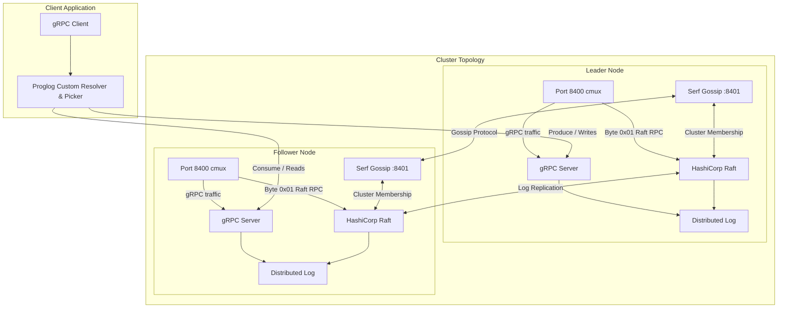

# Prolog (Proglog) — Distributed Commit Log

[](https://golang.org)
[](https://github.com/hashicorp/raft)
[](https://github.com/hashicorp/serf)
[](https://grpc.io)
[](https://casbin.org)

Prolog is a production-grade, distributed, horizontally scalable commit log service written in Go. Inspired by systems like Apache Kafka and built around modern cloud-native distributed systems design, Prolog provides ordered, durable, append-only distributed storage replicated across clusters using the **Raft consensus algorithm**, automated cluster discovery with **Serf gossip**, strict authentication and authorization with **mTLS and Casbin RBAC**, smart client-side **load balancing**, and native **Kubernetes** deployment via Helm.

---

## Table of Contents

- [Architectural Overview](#architectural-overview)
- [System Architecture Diagram](#system-architecture-diagram)
- [Core Subsystems & Design](#core-subsystems--design)
  - [1. Storage Engine (`internal/log`)](#1-storage-engine-internallog)
  - [2. Consensus & Replication (`internal/log/distributed.go`)](#2-consensus--replication-internallogdistributedgo)
  - [3. Single-Port Connection Multiplexing (`cmux`)](#3-single-port-connection-multiplexing-cmux)
  - [4. Discovery & Membership (`internal/discovery`)](#4-discovery--membership-internaldiscovery)
  - [5. Node Lifecycle Orchestration (`internal/agent`)](#5-node-lifecycle-orchestration-internalagent)
  - [6. gRPC Server & API Protocol (`api/v1`, `internal/server`)](#6-grpc-server--api-protocol-apiv1-internalserver)
  - [7. Client-Side Load Balancing & Resolver (`internal/loadbalance`)](#7-client-side-load-balancing--resolver-internalloadbalance)
  - [8. Security & Access Control (`internal/auth`, `internal/config`)](#8-security--access-control-internalauth-internalconfig)
  - [9. Observability & Tracing](#9-observability--tracing)
- [Data Storage Internals & On-Disk Format](#data-storage-internals--on-disk-format)
  - [Store File (`.store`)](#store-file-store)
  - [Index File (`.index`)](#index-file-index)
  - [Segment Lifecycle & Compaction](#segment-lifecycle--compaction)
- [Protobuf API Specification](#protobuf-api-specification)
- [Command Line Interfaces](#command-line-interfaces)
  - [`proglog` Server CLI](#proglog-server-cli)
  - [`getservers` Diagnostic CLI](#getservers-diagnostic-cli)
- [Security & Certificate Setup](#security--certificate-setup)
- [Building & Testing](#building--testing)
  - [Prerequisites](#prerequisites)
  - [Makefile Targets](#makefile-targets)
  - [Running Unit and Integration Tests](#running-unit-and-integration-tests)
- [Deployment & Operations](#deployment--operations)
  - [Docker Container](#docker-container)
  - [Kubernetes & Helm Deployment](#kubernetes--helm-deployment)
- [Repository Structure](#repository-structure)

---

## Architectural Overview

Prolog is organized around decoupled subsystems that cooperate to provide consistency, partition tolerance, and high availability:

1. **Storage Layer**: An append-only log structured as active and read-only segments, backed by raw payload store files and memory-mapped (`gommap`) index files.
2. **Consensus Layer**: HashiCorp Raft manages leader election, log replication across nodes, and snapshotting. Raft's log store itself reuses the storage layer's commit log.
3. **Transport Multiplexing**: Both Raft peer RPCs and client gRPC traffic share a single TCP port using `cmux`, distinguishing Raft packets via a single-byte protocol prefix (`0x01`).
4. **Gossip & Discovery**: HashiCorp Serf runs a decentralized gossip protocol across cluster nodes, automatically detecting joins and node failures, and binding cluster membership changes to Raft.
5. **Intelligent Routing**: A custom gRPC client resolver (`proglog://`) and balancer picker inspect cluster topology: write/produce calls are directed to the Raft leader, while read/consume requests are round-robined across followers.
6. **Defense in Depth**: Mutual TLS (mTLS) verifies peer and client identities, while Casbin enforces role-based access control (RBAC) policies on every RPC call.

---

## System Architecture Diagram



---

## Core Subsystems & Design

### 1. Storage Engine (`internal/log`)

The storage engine is an ordered collection of **segments**, where each segment consists of a pair of files on disk:
- `<baseOffset>.store`: Stores the raw protobuf-serialized records.
- `<baseOffset>.index`: Stores entries mapping relative record offsets to byte positions within the corresponding store file.

#### Key Types:
- **`store` (`internal/log/store.go`)**: Wraps an `*os.File` behind a `sync.Mutex` with a `bufio.Writer`. Writes are prefixed with an 8-byte big-endian unsigned integer indicating record payload size (`lenWidth = 8`). Flushes buffered data prior to `Read` or `ReadAt`.
- **`index` (`internal/log/index.go`)**: Memory-maps an on-disk index file using `gommap`. Index files are pre-allocated to `MaxIndexBytes` upon creation to support contiguous memory mapping and truncated back to their actual size upon `Close()`. Reads and writes use relative 32-bit offsets to conserve space (12 bytes per index entry: 4 bytes relative offset + 8 bytes store position).
- **`segment` (`internal/log/segment.go`)**: Coordinates writes across the store and index files. Computes relative offsets from `baseOffset`, maintains `nextOffset`, and evaluates whether a segment has exceeded `MaxStoreBytes` or `MaxIndexBytes`.
- **`Log` (`internal/log/log.go`)**: Maintains the collection of segments, pointing to the currently `activeSegment`. Provides methods to `Append`, `Read`, `LowestOffset`, `HighestOffset`, `Truncate` (reclaiming disk space up to a threshold offset), and `Reader()` (an `io.MultiReader` spanning all segments for Raft snapshot streaming).

### 2. Consensus & Replication (`internal/log/distributed.go`)

High availability and strong consistency are achieved via HashiCorp Raft:
- **Finite State Machine (`fsm`)**:
  - Implements `raft.FSM`.
  - Replicates `AppendRequestType` operations across quorum.
  - Implements `Snapshot()` by streaming segments via `log.Reader()`.
  - Implements `Restore(io.ReadCloser)` to recover segment state from incoming snapshot streams.
- **Raft LogStore (`logStore`)**:
  - Instead of requiring an external database for Raft's log, Prolog wraps its own `Log` storage engine to satisfy the `raft.LogStore` interface (`StoreLog`, `StoreLogs`, `GetLog`, `FirstIndex`, `LastIndex`, `DeleteRange`).
- **Stable Storage**: BoltDB (`raft-boltdb`) is used for Raft metadata (cluster term, voted-for).
- **Snapshot Storage**: `raft.NewFileSnapshotStore` retains point-in-time state snapshots on disk.
- **Cluster Control**: Provides `Join(id, addr)` and `Leave(id)` to dynamically add and remove cluster nodes.

### 3. Single-Port Connection Multiplexing (`cmux`)

Prolog eliminates the need for separate RPC ports for Raft consensus and gRPC client traffic:
- A single listener binds to `RPCPort` (default `8400`).
- `cmux` inspects the initial byte of incoming connections:
  - If the first byte matches `log.RaftRPC` (`byte(1)`), the connection is routed to the Raft `StreamLayer`.
  - Any standard connection matches `cmux.Any()` and is routed to the `grpc.Server`.
- Raft's `StreamLayer` prepends `byte(1)` during client dials and wraps connections in TLS when peer certificates are provided.

### 4. Discovery & Membership (`internal/discovery`)

Cluster membership is handled dynamically through HashiCorp Serf:
- Nodes run an in-process Serf agent configured with UDP/TCP gossip on `bind-addr` (e.g. port `8401`).
- Each node advertises its RPC address through Serf metadata tags:
  ```go
  Tags: map[string]string{
      "rpc_addr": rpcAddr,
  }
  ```
- Serf membership events (`EventMemberJoin`, `EventMemberLeave`, `EventMemberFailed`) trigger handler hooks:
  - When a new peer joins the gossip cluster, `DistributedLog.Join(id, rpc_addr)` is invoked, adding the node as a Raft voter.
  - When a node leaves or fails, `DistributedLog.Leave(id)` removes it from the Raft quorum.

### 5. Node Lifecycle Orchestration (`internal/agent`)

The `Agent` struct (`internal/agent/agent.go`) manages the component lifecycle:
1. **`setupLogger`**: Instantiates a structured `zap.Logger`.
2. **`setupMux`**: Opens a TCP socket on `RPCPort` and creates a `cmux` multiplexer.
3. **`setupLog`**: Configures the `DistributedLog`, Raft stream layer, BoltDB store, and initializes/joins consensus.
4. **`setupServer`**: Configures authentication interceptors, Casbin authorization, and starts the `grpc.Server`.
5. **`setupMembership`**: Bootstraps Serf gossip and connects to `StartJoinAddrs`.
6. **Graceful Shutdown**: On `SIGINT`/`SIGTERM`, leaves Serf, stops the gRPC server gracefully, and closes the log and Raft stores.

### 6. gRPC Server & API Protocol (`api/v1`, `internal/server`)

The server implements the Protocol Buffers interface defined in `api/v1/log.proto`:
- **Unary RPCs**:
  - `Produce(ProduceRequest)`: Writes a record; checks authorization for `produce` action.
  - `Consume(ConsumeRequest)`: Reads a record by offset; checks authorization for `consume` action.
  - `GetServers(GetServersRequest)`: Queries Raft topology, returning server IDs, RPC addresses, and leader status.
- **Streaming RPCs**:
  - `ProduceStream(stream ProduceRequest) -> stream ProduceResponse`: Bidirectional streaming produce.
  - `ConsumeStream(ConsumeRequest) -> stream ConsumeResponse`: Server-streaming consume that pushes records sequentially and continues streaming as new records arrive.
- **Error Handling**: Custom `ErrOffsetOutOfRange` maps directly to gRPC `codes.NotFound` with rich error details via `google.golang.org/genproto/googleapis/rpc/errdetails.LocalizedMessage`.
- **Health Checks**: Standard gRPC Health Checking Protocol (`grpc.health.v1`) registered on the server.

### 7. Client-Side Load Balancing & Resolver (`internal/loadbalance`)

Prolog includes a custom gRPC load balancer and resolver:
- **Resolver (`internal/loadbalance/resolver.go`)**:
  - Registered under the scheme `proglog:///`.
  - Queries `GetServers` to discover cluster topology and marks servers with attribute `is_leader: true/false`.
- **Picker (`internal/loadbalance/picker.go`)**:
  - Separates connections into `leader` and `followers`.
  - **Produce routing**: Routes calls with method names containing `"Produce"` exclusively to the leader node.
  - **Consume routing**: Routes calls containing `"Consume"` round-robin across follower nodes using atomic indexing. If no followers are active, falls back to the leader.

### 8. Security & Access Control (`internal/auth`, `internal/config`)

- **Mutual TLS (mTLS)**:
  - Supports configurable CA, server certificates, and client certificates.
  - Verifies SAN (Subject Alternative Names) and Hostnames.
  - Extracts the client's `CommonName` (CN) from `credentials.TLSInfo` inside the gRPC authentication interceptor to establish caller identity.
- **Casbin RBAC (`internal/auth/authorizer.go`)**:
  - Enforces access rules defined in `model.conf` and `policy.csv`.
  - Example policy rules:
    ```csv
    p, root, *, produce
    p, root, *, consume
    ```
  - Rejects unauthorized operations with `codes.PermissionDenied`.

### 9. Observability & Tracing

- **Structured Logging**: `go.uber.org/zap` interceptors log request metadata and duration in nanoseconds (`grpc.time_ns`).
- **Distributed Tracing**: Integrated with `go.opencensus.io` (`ocgrpc.ServerHandler`), with `trace.AlwaysSample()` enabled for distributed span collection.

---

## Data Storage Internals & On-Disk Format

### Store File (`.store`)

Binary structure of records written to disk:

```
+-----------------------------------+-----------------------------------+
| Record Length (8 bytes, BigEndian)| Protobuf Record Payload (N bytes) |
+-----------------------------------+-----------------------------------+
```

Each append operation returns:
- Number of bytes written ($8 + N$).
- Byte position where the record starts in the store file.

### Index File (`.index`)

The index uses fixed-size 12-byte entries memory-mapped into user space:

```
+-----------------------------------+-----------------------------------+
| Relative Offset (4 bytes, uint32) | Store Position (8 bytes, uint64)  |
+-----------------------------------+-----------------------------------+
|<------------ 4 bytes ------------>|<------------ 8 bytes ------------>|
```

- **Relative Offsets**: Offsets in the index are relative to `segment.baseOffset`, fitting inside 4 bytes (`uint32`).
- **Constant Time Lookups**: To read offset $K$, the index position is calculated directly as:
  $$\text{Index Byte Position} = (K - \text{baseOffset}) \times 12$$
- **Pre-allocation**: Index files are initialized to `MaxIndexBytes` (default 1024 bytes in tests, configurable). On shutdown, they are truncated down to `index.size` to reclaim disk space.

### Segment Lifecycle & Compaction

1. **Active Segment**: Only the latest segment accepts writes.
2. **Rollover**: When `IsMaxed()` returns true (store size $\ge$ `MaxStoreBytes` or index size $\ge$ `MaxIndexBytes`), the active segment becomes read-only and a new segment is created with base offset $\text{lastOffset} + 1$.
3. **Log Compaction / Truncation**: `Log.Truncate(lowest uint64)` removes all closed segments whose highest offset is less than or equal to `lowest`, safely reclaiming disk space without interrupting active consumers.

---

## Protobuf API Specification

Defined in `api/v1/log.proto`:

```protobuf
syntax = "proto3";

package log.v1;

option go_package = "github.com/Favour-MK/prolog/api/log_v1";

message Record {
  bytes value = 1;
  uint64 offset = 2;
  uint64 term = 3;
  uint32 type = 4;
}

service Log {
  rpc Produce(ProduceRequest) returns (ProduceResponse) {}
  rpc Consume(ConsumeRequest) returns (ConsumeResponse) {}
  rpc ConsumeStream(ConsumeRequest) returns (stream ConsumeResponse) {}
  rpc ProduceStream(stream ProduceRequest) returns (stream ProduceResponse) {}
  rpc GetServers(GetServersRequest) returns (GetServersResponse) {}
}

message ProduceRequest {
  Record record = 1;
}

message ProduceResponse {
  uint64 offset = 1;
}

message ConsumeRequest {
  uint64 offset = 1;
}

message ConsumeResponse {
  Record record = 2;
}

message GetServersRequest {}

message GetServersResponse {
  repeated Server servers = 1;
}

message Server {
  string id = 1;
  string rpc_addr = 2;
  bool is_leader = 3;
}
```

---

## Command Line Interfaces

### `proglog` Server CLI

The main daemon binary is located at `cmd/server/main.go`. It uses Cobra and Viper for configuration via CLI flags, environment variables, or configuration files.

#### CLI Flags

| Flag | Default | Description |
| :--- | :--- | :--- |
| `--config-file` | `""` | Path to YAML/JSON configuration file |
| `--data-dir` | `/var/run/proglog` | Directory storing commit logs, Raft logs, and BoltDB state |
| `--node-name` | `$(hostname)` | Unique identifier for this cluster node |
| `--bind-addr` | `127.0.0.1:8401` | Address and port for Serf gossip membership |
| `--rpc-port` | `8400` | Port for client gRPC requests and Raft consensus RPCs |
| `--start-join-addrs` | `[]` | Seed addresses of other Serf cluster members to join |
| `--bootstrap` | `false` | Whether this node bootstraps the initial Raft cluster |
| `--acl-model-file` | `""` | Path to Casbin ACL model configuration file |
| `--acl-policy-file`| `""` | Path to Casbin ACL policy CSV file |
| `--server-tls-cert-file` | `""` | Path to server TLS certificate |
| `--server-tls-key-file` | `""` | Path to server TLS private key |
| `--server-tls-ca-file` | `""` | Path to certificate authority for verifying clients |
| `--peer-tls-cert-file` | `""` | Path to client TLS cert used for peer-to-peer RPCs |
| `--peer-tls-key-file` | `""` | Path to client TLS key used for peer-to-peer RPCs |
| `--peer-tls-ca-file` | `""` | Path to certificate authority for verifying peer servers |
| `--peer-tls-server-name`| `""` | Server name to verify against peer certificates |

#### Example: Starting a 3-Node Cluster Locally

**Node 0 (Bootstrap Leader):**
```bash
proglog \
  --node-name=node-0 \
  --data-dir=/tmp/proglog/node-0 \
  --bind-addr=127.0.0.1:8401 \
  --rpc-port=8400 \
  --bootstrap=true \
  --acl-model-file=$HOME/.proglog/model.conf \
  --acl-policy-file=$HOME/.proglog/policy.csv \
  --server-tls-cert-file=$HOME/.proglog/server.pem \
  --server-tls-key-file=$HOME/.proglog/server-key.pem \
  --server-tls-ca-file=$HOME/.proglog/ca.pem \
  --peer-tls-cert-file=$HOME/.proglog/root-client.pem \
  --peer-tls-key-file=$HOME/.proglog/root-client-key.pem \
  --peer-tls-ca-file=$HOME/.proglog/ca.pem
```

**Node 1 (Follower):**
```bash
proglog \
  --node-name=node-1 \
  --data-dir=/tmp/proglog/node-1 \
  --bind-addr=127.0.0.1:8403 \
  --rpc-port=8402 \
  --start-join-addrs=127.0.0.1:8401 \
  --acl-model-file=$HOME/.proglog/model.conf \
  --acl-policy-file=$HOME/.proglog/policy.csv \
  --server-tls-cert-file=$HOME/.proglog/server.pem \
  --server-tls-key-file=$HOME/.proglog/server-key.pem \
  --server-tls-ca-file=$HOME/.proglog/ca.pem \
  --peer-tls-cert-file=$HOME/.proglog/root-client.pem \
  --peer-tls-key-file=$HOME/.proglog/root-client-key.pem \
  --peer-tls-ca-file=$HOME/.proglog/ca.pem
```

---

### `getservers` Diagnostic CLI

Located at `cmd/getservers/main.go`, this utility queries the cluster via gRPC to inspect active servers and leader status.

```bash
# Query an insecure local node
go run ./cmd/getservers --addr=127.0.0.1:8400

# Query a secure mTLS node
go run ./cmd/getservers \
  --addr=127.0.0.1:8400 \
  --ca-file=$HOME/.proglog/ca.pem \
  --cert-file=$HOME/.proglog/root-client.pem \
  --key-file=$HOME/.proglog/root-client-key.pem \
  --server-name=127.0.0.1
```

**Sample Output:**
```text
servers:
	- id:"node-0" rpc_addr:"127.0.0.1:8400" is_leader:true
	- id:"node-1" rpc_addr:"127.0.0.1:8402"
	- id:"node-2" rpc_addr:"127.0.0.1:8404"
```

---

## Security & Certificate Setup

Prolog uses Cloudflare's `cfssl` and `cfssljson` to generate the Public Key Infrastructure (PKI).

To initialize the configuration path and generate all CA, server, and client certificates:

```bash
make init
make gencert
```

This creates the following files in `${HOME}/.proglog/`:
- `ca.pem`, `ca-key.pem`: Certificate Authority.
- `server.pem`, `server-key.pem`: Server certificate covering `localhost`, `127.0.0.1`, and Kubernetes cluster DNS names (`*.proglog.default.svc.cluster.local`).
- `root-client.pem`, `root-client-key.pem`: Root client certificate with Common Name `root` (authorized to `produce` and `consume`).
- `nobody-client.pem`, `nobody-client-key.pem`: Client certificate with Common Name `nobody` (unauthorized identity).
- `model.conf`, `policy.csv`: Casbin ACL model and policies.

---

## Building & Testing

### Prerequisites

- **Go**: Version 1.26 or higher
- **Protobuf Compiler (`protoc`)**: `v3+` with plugins `protoc-gen-go` and `protoc-gen-go-grpc`
- **CFSSL**: `cfssl` and `cfssljson` for TLS generation
- **Docker**: For container builds
- **Kubectl & Helm**: For Kubernetes deployment

### Makefile Targets

| Target | Description |
| :--- | :--- |
| `make init` | Creates `${HOME}/.proglog/` config directory |
| `make gencert` | Generates all CA, server, and client mTLS certificates |
| `make compile` | Compiles `api/v1/*.proto` to Go gRPC code |
| `make test` | Copies ACL policies and runs all tests with `-race` detection |
| `make build-docker` | Builds the multi-stage minimal Docker container image |
| `make k8s-tls-secret` | Creates the `proglog-tls` Kubernetes secret with CA, server, and client certificates |
| `make deploy` | Deploys the Helm chart to Kubernetes |

### Running Unit and Integration Tests

Run the full test suite with race detector enabled:

```bash
make test
```

Or run tests across packages directly:

```bash
go test -v -race ./...
```

---

## Deployment & Operations

### Docker Container

The `Dockerfile` utilizes a multi-stage build:
1. **Builder Stage (`golang:1.26-alpine`)**: Compiles `proglog` and `getservers` statically without CGO, and fetches `grpc-health-probe`.
2. **Runtime Stage (`gcr.io/distroless/static-debian12`)**: Minimal, attack-surface-free distroless image containing only the compiled binaries.

```bash
make build-docker TAG=0.0.1
```

### Kubernetes & Helm Deployment

Prolog includes a Helm chart configured for production deployments at `deploy/proglog`:

- **StatefulSet (`deploy/proglog/templates/statefulset.yaml`)**:
  - Provides stable network hostnames (`proglog-0`, `proglog-1`, `proglog-2`).
  - Init container (`config-init`) inspects `$HOSTNAME`:
    - Pod 0 automatically sets `bootstrap: true`.
    - Pods $> 0$ set `bootstrap: false` and point `start-join-addrs` to `proglog-0`.
  - Mounts persistent volume claims (`VolumeClaimTemplates`) for commit log data storage.
  - Mounts Casbin ACL files from ConfigMaps and TLS credentials from Secrets.
- **Headless Service (`deploy/proglog/templates/service.yaml`)**:
  - Configures `clusterIP: None` with `publishNotReadyAddresses: true` so pods can discover and resolve each other prior to becoming ready.
- **Health Probes**:
  - Uses `grpc_health_probe` with mTLS to perform liveness and readiness health checks directly against the gRPC service port.

#### Deploying with Helm:

```bash
# 1. Generate certificates and create the Kubernetes TLS secret
make gencert
make k8s-tls-secret

# 2. Deploy Helm chart
helm upgrade --install proglog deploy/proglog --set image.tag=0.0.1
```

---

## Repository Structure

```
.
├── Dockerfile                          # Multi-stage minimal distroless Dockerfile
├── Makefile                            # Build, cert generation, test, and deploy automation
├── go.mod                              # Go module definition and dependencies
├── go.sum                              # Checksums for Go dependencies
├── api/
│   └── v1/
│       ├── log.proto                   # Protobuf service and message definitions
│       ├── log.pb.go                   # Generated Protobuf code
│       ├── log_grpc.pb.go              # Generated gRPC server and client interfaces
│       └── error.go                    # Custom gRPC error definitions (ErrOffsetOutOfRange)
├── cmd/
│   ├── server/
│   │   └── main.go                     # Main proglog daemon CLI entrypoint (Cobra/Viper)
│   └── getservers/
│       └── main.go                     # Diagnostic CLI tool to query cluster status
├── internal/
│   ├── agent/
│   │   ├── agent.go                    # Orchestrator binding Log, Raft, gRPC, Serf, and Mux
│   │   └── agent_test.go               # End-to-end multi-agent integration tests
│   ├── auth/
│   │   └── authorizer.go               # Casbin-based RBAC authorization enforcer
│   ├── config/
│   │   ├── files.go                    # Standard configuration file path resolvers
│   │   └── tls.go                      # TLS and mTLS configuration helpers
│   ├── discovery/
│   │   ├── membership.go               # HashiCorp Serf gossip membership handler
│   │   └── membership_test.go          # Serf cluster membership unit tests
│   ├── loadbalance/
│   │   ├── resolver.go                 # Custom gRPC resolver querying GetServers
│   │   ├── resolver_test.go            # Resolver unit tests
│   │   ├── picker.go                   # Custom gRPC picker (leader produce, follower consume)
│   │   └── picker_test.go              # Picker routing unit tests
│   ├── log/
│   │   ├── store.go                    # Length-prefixed record file storage
│   │   ├── store_test.go               # Store append and read tests
│   │   ├── index.go                    # Memory-mapped (mmap) offset-to-position index
│   │   ├── index_test.go               # Index boundary and mmap tests
│   │   ├── segment.go                  # Store + Index coordinated segment abstraction
│   │   ├── segment_test.go             # Segment size maxing and rollover tests
│   │   ├── log.go                      # Multi-segment commit log implementation
│   │   ├── log_test.go                 # Commit log setup, read, append, truncate tests
│   │   ├── config.go                   # Segment and Raft configuration parameters
│   │   ├── distributed.go              # HashiCorp Raft FSM, StreamLayer, and LogStore
│   │   ├── distributed_test.go         # Distributed multi-node consensus tests
│   │   └── replicator.go               # Peer log streaming replication helper
│   └── server/
│       ├── server.go                   # gRPC server implementation with auth & tracing
│       ├── server_test.go              # Comprehensive gRPC server test suite
│       ├── http.go                     # Lightweight REST/HTTP commit log server
│       └── log.go                      # In-memory thread-safe log used by HTTP server
├── deploy/
│   └── proglog/                        # Kubernetes Helm Chart
│       ├── Chart.yaml                  # Chart metadata
│       ├── values.yaml                 # Configurable values (replicas, ports, storage)
│       ├── files/
│       │   ├── model.conf              # Casbin model bundled with chart
│       │   └── policy.csv              # Casbin policies bundled with chart
│       └── templates/
│           ├── _helpers.tpl            # Template helper macros and health probes
│           ├── configmap.yaml          # ACL ConfigMap definition
│           ├── service.yaml            # Headless Service definition
│           └── statefulset.yaml        # StatefulSet with config init container
└── test/
    ├── ca-config.json                  # CFSSL CA profile configuration
    ├── ca-csr.json                     # CFSSL CA certificate signing request
    ├── server-csr.json                 # CFSSL Server certificate signing request
    ├── client-csr.json                 # CFSSL Client certificate signing request
    ├── model.conf                      # Casbin RBAC model definition
    └── policy.csv                      # Casbin default RBAC policies
```

---

## License

This project is licensed under the MIT License.

